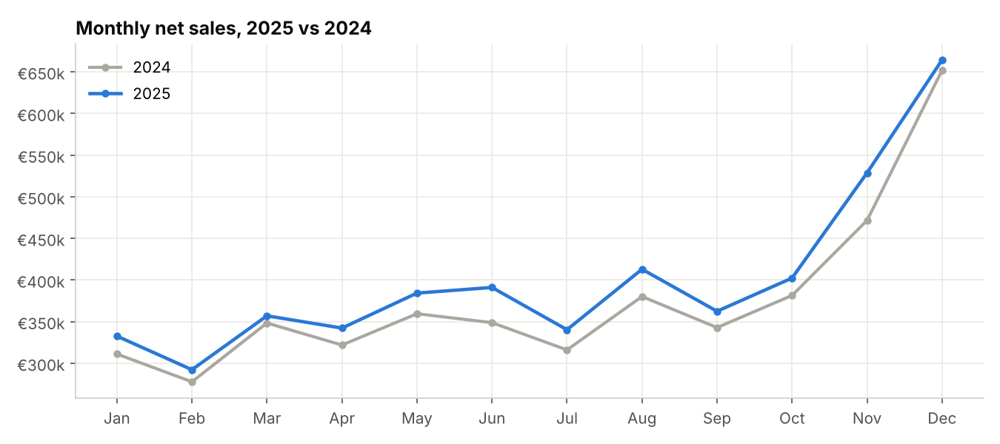
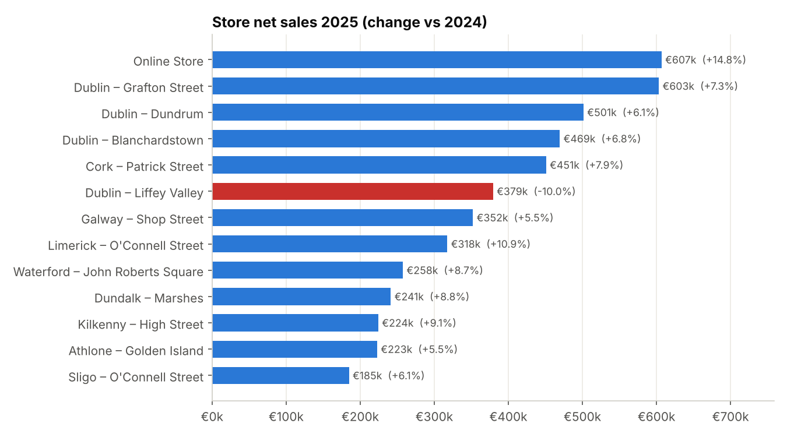

# Irish Retail Sales Analytics: Python, SQL and an Interactive Dashboard

An end-to-end data analytics project for **Clover & Co.**, a fictional Irish fashion and homeware retailer with 12 stores (Dublin, Cork, Galway, Limerick, Waterford, Kilkenny, Athlone, Sligo, Dundalk) and an online shop.

The project covers **two years of sales (2024–2025): about 115,000 orders and 210,000 order lines**. It goes from raw, messy data to a cleaned SQL database, then to business analysis and an interactive dashboard.

> **Note on data:** all data is **synthetic**. I generated it in Python to behave like real Irish retail data, including Black Friday, the Christmas peak, January sales, back-to-school, St Patrick's weekend, shops closed on 25–26 December, Irish bank holidays, 23% VAT and regional differences. No real company or customer data is used.



---

## What this project shows

| Skill | Where |
|---|---|
| **Data cleaning** (pandas) | `src/clean_load.py` removes duplicates, standardises text, handles missing and invalid values, and logs every fix |
| **Database design** (SQL) | `sql/schema.sql` is a star-style schema with primary and foreign keys, CHECK constraints, indexes and a reporting view |
| **SQL analysis** | `sql/analysis/` holds 11 queries using CTEs, joins, `CASE`, and window functions (`LAG`, `RANK`, `ROW_NUMBER`, `NTILE`, running totals) |
| **Customer segmentation** | RFM (Recency, Frequency, Monetary) analysis in pure SQL |
| **Data visualisation** | matplotlib charts, plus a self-contained interactive dashboard in HTML/JavaScript/SVG |
| **Business insight** | Plain-English findings with recommendations (below) |
| **Reproducibility** | One command rebuilds everything from scratch with a fixed random seed |

## The dashboard

Open **`dashboard/index.html`** in any browser. It needs no installs and no internet connection.

- KPI tiles: net sales, orders, average order value, gross margin, return rate, each compared with the previous year
- Monthly sales trend, 2025 vs 2024, with hover tooltips and a **category filter**
- Store league table and growth by region
- Category mix with margin and returns
- In-store footfall heatmap by weekday and hour
- Peak trading periods and RFM customer segments
- Works on mobile and supports dark mode

## How to run it

```bash
pip install -r requirements.txt
python main.py
```

The pipeline:

```
generate_data.py  →  data/raw/*.csv           (synthetic raw exports, with deliberate data-quality issues)
clean_load.py     →  data/retail.db           (cleaned and loaded into SQLite)
run_analysis.py   →  outputs/*.csv            (results of every SQL query)
make_charts.py    →  outputs/charts/*.png     (static charts)
build_dashboard.py→  dashboard/index.html     (interactive dashboard)
```

You can also explore the database yourself with any SQLite tool (e.g. DB Browser for SQLite). Start with the view `v_sales_lines`.

## Data model

```
              calendar
                 │
stores ── orders ── customers
            │
       order_items ── products
```

- **orders**: one row per transaction (date and time, store, channel, payment method, loyalty customer)
- **order_items**: one row per product line (quantity, price, discount, returned flag)
- **v_sales_lines**: a reporting view that joins everything and calculates net sales ex VAT and gross profit

## Data cleaning log

The raw data contains problems that are common in real point-of-sale exports. The cleaning script fixes them and records how many rows each fix affected (`outputs/data_quality_log.csv`):

| Issue | Rows fixed |
|---|---|
| Inconsistent payment-method text (`"CONTACTLESS "` vs `"Contactless"`) | 2,301 |
| Duplicate orders exported twice | 458 |
| Messy county names (`"Co. cork"` → `"Cork"`) | 540 |
| Missing quantities (lines dropped) | 632 |
| Negative quantities from keying errors (corrected) | 208 |

## Key findings (2025 vs 2024)

1. **Net sales grew 6.6% to €4.81m.** The growth came from more orders (+6.9%), not bigger baskets: average order value stayed flat at about €81.
2. **Online is now the biggest "store"** (€607k, 12.6% of sales) and the fastest grower (+14.8%).
3. **Liffey Valley fell 10%** while it was partly closed for a refit in spring 2025. It was the only store in decline, and it held Dublin's growth to 3.1%. Munster grew fastest at 9.0%.
4. **Womenswear is the largest category** (28.9% of sales). **Homeware and Accessories have the best margins** (~61%). Womenswear and Footwear have the highest return rates (5.6%).
5. **Black Friday weekend trades at 2.4× a normal day**, ahead of the final 10 days before Christmas (2.1×).
6. **Saturday afternoon is the busiest in-store time.** Mornings before 11:00 are quiet every day.
7. **"Champions" (20% of loyalty members) generate 39% of loyalty sales.** 2,647 "At Risk" customers, who used to buy often but haven't bought in about 8 months, spent €1.0m in total.



## Recommendations

- **Invest in online**: it is growing more than twice as fast as stores. Return rates are higher online, so review sizing guides for Womenswear and Footwear.
- **Win back "At Risk" customers** with a targeted loyalty email or offer. This group spent €1.0m over the two years, so even a small reactivation rate is worth the effort.
- **Roster staff to footfall**: put more staff on Saturday 12:00–18:00 and fewer on weekday mornings.
- **Plan stock and staffing around Black Friday**, the single biggest trading moment of the year.
- **Push higher-margin categories** (Homeware, Accessories) in Q4 gifting campaigns.

## Project structure

```
irish-retail-sales-analytics/
├── main.py                  # runs the whole pipeline
├── requirements.txt
├── src/
│   ├── generate_data.py     # synthetic data generator
│   ├── clean_load.py        # cleaning + load to SQLite
│   ├── run_analysis.py      # runs every SQL file → CSV
│   ├── make_charts.py       # matplotlib charts
│   └── build_dashboard.py   # builds the interactive dashboard
├── sql/
│   ├── schema.sql
│   └── analysis/01–11_*.sql
├── data/raw/                # generated raw CSVs
├── outputs/                 # query results, charts, data-quality log
└── dashboard/
    ├── template.html        # dashboard layout + chart code
    └── index.html           # built dashboard (open this)
```

## Tools

Python 3 (pandas, NumPy, matplotlib) · SQLite / SQL · HTML, CSS and JavaScript (SVG charts, no libraries)

---

*Author: Matthew Shaw, Dublin. QQI Level 7 Data Analytics for Business.*
